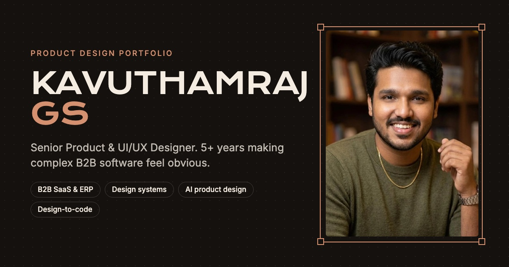

# Kavuthamraj GS, Product Design Portfolio

The portfolio of **Kavuthamraj GS** (Kavuthamraj Geetha Senthilkumar), a Senior UI/UX and Product Designer with 5+ years across B2B SaaS, ERP and back-office tools, and consumer apps. The site presents selected case studies, experience, skills and recommendations for recruiters and hiring managers.



| | |
|---|---|
| **Website** | https://www.kavuthamraj.com (canonical; the apex domain redirects here) |
| **Previous address** | https://kavuthamraj-website-red.vercel.app/ (permanently redirects to the website above) |
| **LinkedIn** | https://www.linkedin.com/in/kavuthamraj/ |
| **Behance** | https://www.behance.net/gallery/224132329/ERP-Solutionfor-Sports-Industry |
| **Email** | kavutham99raj@gmail.com |

## How it is built

A hand-written static site with no framework and no npm dependencies.

- **HTML** is generated by one Node.js script, [`src/build.mjs`](src/build.mjs), from content in [`src/data.mjs`](src/data.mjs) (profile, experience, skills, featured work, testimonials) and [`src/framer-cases.mjs`](src/framer-cases.mjs) (case-study pages).
- **CSS and JavaScript** are plain files: [`static/styles.css`](static/styles.css) and [`static/main.js`](static/main.js). Links to them carry a content hash (`?v=…`), so browsers fetch new versions after each change.
- **Fonts:** Krona One and Inter, served by Google Fonts (fonts.gstatic.com). The `@font-face` rules are written into each page by `head()` (latin and latin-ext only) and the latin files are preloaded, so no render-blocking font stylesheet is needed.
- **Images:** every image under `static/work` has WebP copies at up to four widths (800, 1200, 1600, 2400, never larger than the original), listed in `static/img.json`. The build emits `srcset`/`sizes` from that list, so phones download small files. The original JPEGs stay for social previews and the "Open full size" links.
- **Caching** (`vercel.json`): `styles.css?v=` and `main.js?v=` are cached for a year (the hash changes with every edit); images are cached for a day and then refreshed in the background. HTML always revalidates, so a deploy shows at once.
- **Hosting:** Vercel, deploying from the `main` branch of this repository. Vercel runs `npm run build` and serves the generated `dist/` folder.

### Project structure

```text
scripts/
  images.mjs         makes WebP copies of static/work images and writes static/img.json
  lock.mjs           encrypts the private interview assignment into static/private/assignment.enc
src/
  build.mjs          builds every page plus robots.txt, sitemap.xml, llms.txt, site.webmanifest
  data.mjs           site URLs, profile, experience, skills, proof figures, featured work, testimonials
  framer-cases.mjs   case-study content (blocks of headings, text, images)
static/
  styles.css, main.js
  profile.webp, profile-portrait.jpg      portrait (hero and structured data)
  favicon.ico, favicon-32.png, favicon-96.png, apple-touch-icon.png, icon-192.png, icon-512.png
  og-image.jpg                            1200×630 social-sharing image
  logos/                                  company logos
  work/                                   case-study images, covers and slides
  resume.pdf                              published as Kavuthamraj_Resume_UI_UX_Product_Designer.pdf (and resume.pdf for old links)
dist/                generated by the build (git-ignored)
PORTFOLIO-AUDIT.md   design and content audit notes
```

### Run it locally

Requires Node.js (the build uses only built-in modules; developed on Node 22).

```bash
npm run build
```

```bash
python3 -m http.server 4321 --directory dist
```

Then open http://localhost:4321. There is no lint or test script; the build prints `Built 16 pages → dist/` when it succeeds.

To edit content, change `src/data.mjs` or `src/framer-cases.mjs` and rebuild.

A private interview assignment is not in the repository. Its data and images live in `private/` (ignored by git; keep your own backup), and the site publishes only a password page at `/work/assignment.html` plus an encrypted file. To change the password or the content, run `node scripts/lock.mjs <password>` and then `npm run build`. The password is not stored anywhere in the repository.

After adding or replacing an image under `static/work`, make its WebP copies (macOS, needs Google Chrome; no packages):

```bash
node scripts/images.mjs
```

It only converts images that are not yet in `static/img.json`; pass `--all` to redo every image after replacing files in place. Every `<head>` is generated by `head()` in `src/build.mjs`.

## Features

- Home page: hero with an opening animation, proof figures, three flagship case studies, more work and concepts, how I work, design-system specimen, experience timeline, Figma activity, skills, testimonials and contact.
- 14 case-study pages under `/work/`, with chapter navigation and next-case links.
- Accessibility: a skip link, semantic landmarks, one `h1` per page, an `alt` attribute on every image (empty for decorative ones), visible keyboard focus. Motion respects `prefers-reduced-motion`, and visitors with reduced motion can opt in with the hero's "Play motion" button.
- Responsive from phones to wide desktops.

## SEO and discoverability

All of this is generated by `src/build.mjs`; nothing below is hand-edited in `dist/`.

| What | Where | Notes |
|---|---|---|
| Canonical origin | `SITE` in `src/build.mjs` | `site.live` in `src/data.mjs` (`https://www.kavuthamraj.com`). `SITE_URL` can override it for a test build. Used by canonical tags, Open Graph, Twitter cards, JSON-LD, sitemap, robots.txt and llms.txt. |
| Titles and descriptions | `head()` | Unique per page. Home: "Kavuthamraj GS – Senior Product Designer & UI/UX Portfolio". Case pages: "<Project> – UX Case Study \| Kavuthamraj GS" (concepts say "UI/UX Concept"). Descriptions are cut at a word boundary under 160 characters. |
| Robots | `head()` | Indexable pages: `index,follow,max-image-preview:large`. `404.html`: `noindex`, no canonical, not in the sitemap. |
| Open Graph and Twitter | `head()` | Home uses `og-image.jpg` (1200×630). Case pages use their own cover or slide. |
| Structured data | `homeLd` and `fcPage()` | Home: one JSON-LD `@graph` with `WebSite`, `ProfilePage` and `Person` (stable `@id`s, `sameAs` LinkedIn and Behance, `knowsAbout`, `alumniOf`). Case pages: `CreativeWork` (author is the same `Person`) and a `BreadcrumbList`. |
| Sitemap | `/sitemap.xml` | Home plus the 14 case-study pages, on the canonical origin. |
| robots.txt | `/robots.txt` | Allows everything and points to the sitemap. |
| llms.txt | `/llms.txt` | A plain-text summary of the profile and links to each case study, for AI tools that read it. It is a courtesy, not a ranking factor. |
| Favicons | `static/` | Made from the professional portrait: a round face crop for `favicon.ico` (16, 32 and 48px), `favicon-32.png` and `favicon-96.png`, plus a square crop for `apple-touch-icon.png` (180px) and the manifest icons (192 and 512px). |
| Web manifest | `/site.webmanifest` | Name, colours and the 192 and 512px icons. |
| Redirects | `vercel.json` | The old `*.vercel.app` production address permanently redirects to `www`, path for path. Preview deployments are unaffected. |
| Verification | `site.verify` in `src/data.mjs` | Paste the Google Search Console or Bing Webmaster Tools HTML-tag code (only the `content` value). The meta tag is printed only when a value is set. |

## Search Console and Bing

Set up for `https://www.kavuthamraj.com`:

1. **Google Search Console:** add a **Domain** property for `kavuthamraj.com` (DNS TXT record), or a URL-prefix property for `https://www.kavuthamraj.com/`. Submit `https://www.kavuthamraj.com/sitemap.xml`.
2. **Bing Webmaster Tools:** import the site from Search Console, or add it directly, then submit the same sitemap.
3. **Old property:** the `kavuthamraj-website-red.vercel.app` property can stay for a few months so Search Console shows the move. Use **Change of address** if it is offered for that property.

## Licence

No open-source licence. The content, case studies, images and résumé are © Kavuthamraj GS; please ask before reusing them.
